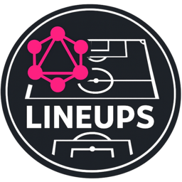
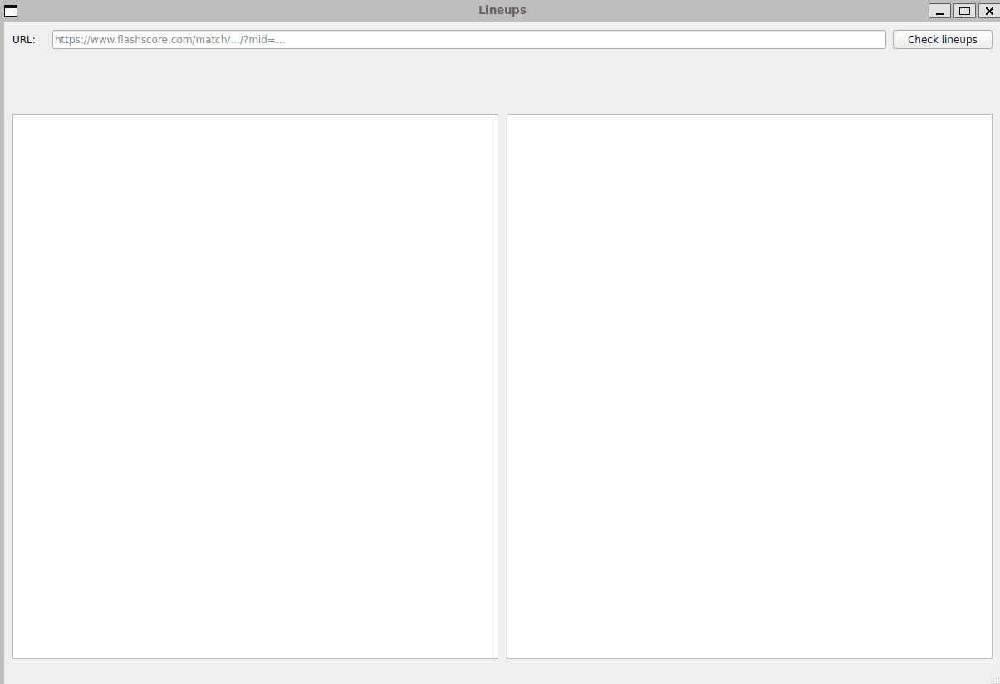
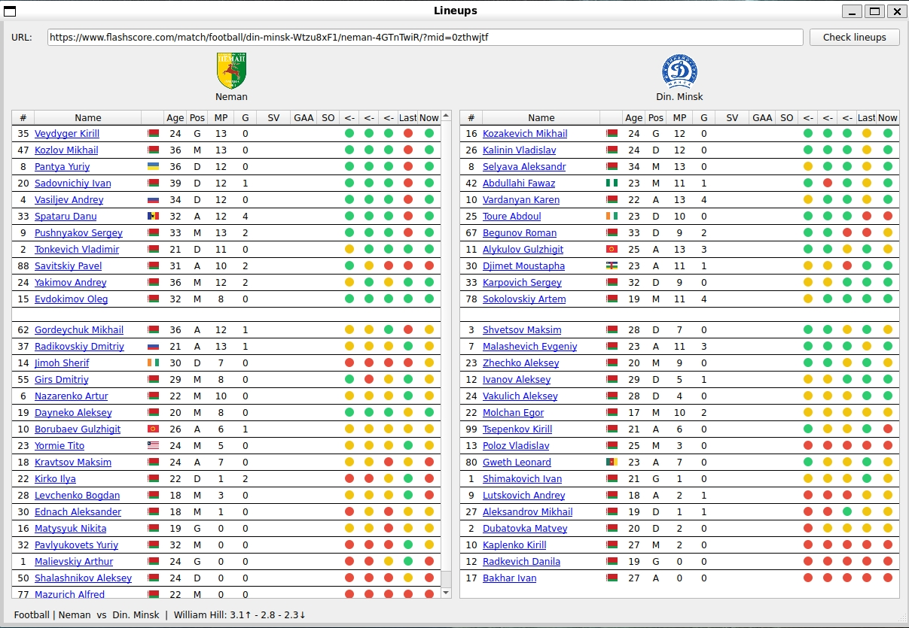
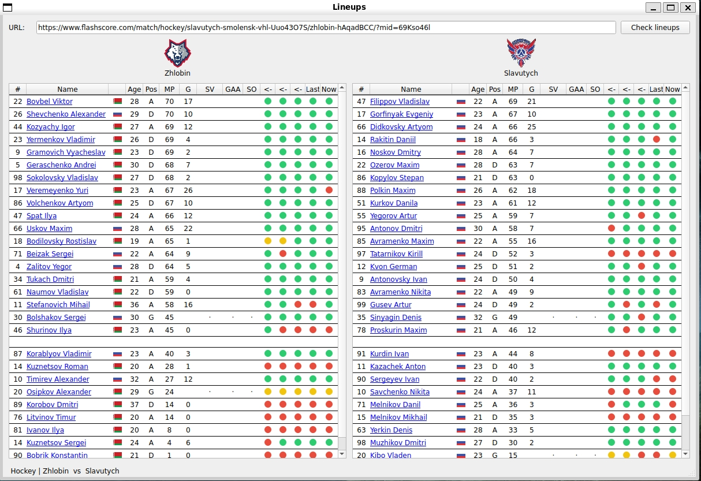

English | [Русский](README.ru.md)

<p align="center">
  
</p>

<h1 align="center">Flashscore Lineups</h1>

<p align="center">
  Desktop application for retrieving and visualizing football and ice hockey lineups 
  directly from Flashscore's internal GraphQL API without browser automation.
</p>

<p align="center">
  <a href="https://python.org">
    
  </a>
  
  
  
  
  
</p>

<p align="center">
  <a href="#demo">Demo</a> •
  <a href="#features">Features</a> •
  <a href="#tech-stack">Tech Stack</a> •
  <a href="#engineering-highlights">Engineering Highlights</a> •
  <a href="#architecture">Architecture</a> •
  <a href="#installation">Installation</a>
</p>


## Demo

### Application Workflow

<p align="center">
  
</p>

<table align="center" style="border: none;">
  <tr>
    <td align="center" style="padding: 0 10px;"></td>
    <td align="center" style="padding: 0 10px;"></td>
  </tr>
  <tr>
    <td align="center"><b>Football</b></td>
    <td align="center"><b>Ice Hockey</b></td>
  </tr>
</table>

The application retrieves data directly from Flashscore's internal GraphQL API and squad HTML pages, then aggregates it into a unified desktop view: team lineups, player availability history, and available 1X2 betting odds.

No Selenium, browser automation, or web rendering is involved — all data is collected through direct HTTP requests.


## Features

* Retrieve football and ice hockey lineups directly from Flashscore
* Display starting lineups, substitutes, and player positions
* Visualize player availability across the last 4 matches with color-coded dots
* Fetch player details including nationality, age, appearances, and goals
* Display hockey-specific goalie statistics (SV%, GAA, shutouts)
* Display available 1X2 betting odds with change direction indicators
* Load team logos and country flags directly from Flashscore CDN
* Open player Flashscore profiles with a single click
* Cross-platform desktop interface built with PyQt5


## Tech Stack

- **Python 3.12+** — core application language.
- **PyQt5** — cross-platform desktop GUI.
- **requests** — HTTP communication with Flashscore endpoints.
- **Beautiful Soup 4 / lxml** — HTML parsing and data extraction.
- **GraphQL** — retrieval of match, lineup, and betting odds data.
- **pytest** — automated unit and integration testing.
- **PyInstaller** — standalone executable packaging.
- **GitHub Actions** — automated testing and Windows builds.


## Engineering Highlights

* Reverse-engineered Flashscore's internal GraphQL endpoints
* Multi-source data pipeline combining persisted GraphQL queries with HTML parsing
* Domain-driven data models implemented with Python dataclasses
* Automated unit and integration tests with pytest
* Structured into domain, service, UI, and testing layers
* Optimized request flow using lightweight HTTP requests instead of browser automation


## Architecture

```text
                       Match URL
                           │
                           ▼
                    Match ID Parser
                           │
                           ▼
                 Flashscore GraphQL API
                           │
                ┌──────────┼──────────┐
                │                     │
                ▼                     ▼
              dsof                 dlie2
           (match info,          (current
           team IDs,             lineups,
           last events)          status map)
                │                     │
                └──────────┬──────────┘
                           │
                           ▼
                    Previous Matches
                      (dlie2 × N)
                           │
                           ▼
                    Squad HTML Pages
                        (×2 teams)
                           │
                           ▼
                     Odds Pipeline
                ┌──────────┴──────────┐
                ▼                     ▼
              pobtm          →    ope2 × N
           (bookmaker             (1X2 odds
             list)               per bookmaker)
                           │
                           ▼
                 Data Aggregation Layer
                           │
                           ▼
                    Domain Data Models
           (Match, Team, Player, Odds, LineupResult)
                           │
                           ▼
                      PyQt5 GUI
```

The application combines persisted GraphQL queries with supplementary HTML parsing and transforms the retrieved data into strongly typed domain models before rendering the final desktop interface.


## Status Colors

| Color | Status     | Meaning                              |
| ----- |------------| ------------------------------------ |
| 🟢    | Starter    | Player started the match             |
| 🟡    | Substitute | Player was on the bench              |
| 🔴    | Absent     | Player was not included in the squad |
| ⚪    | Unknown    | Historical data unavailable          |


## Installation

Clone the repository:

```bash
git clone https://github.com/nikolaitolmachev/flashscore-lineups.git
cd flashscore-lineups
```

Create and activate a virtual environment:

```bash
python -m venv .venv
```

**Linux / macOS**

```bash
source .venv/bin/activate
```

**Windows**

```powershell
.venv\Scripts\activate
```

Install dependencies:

```bash
python -m pip install --upgrade pip
pip install -r requirements.txt
```

## Usage

Launch the application:

```bash
python main.py
```

Paste a Flashscore match URL into the input field and click **Check lineups**.


## Downloads

Pre-built Windows executables are available in the Releases section.

No Python installation is required.


## Build Executable

Build a standalone executable using PyInstaller:

```bash
pip install pyinstaller

pyinstaller -F -w --icon=assets/icon.ico --name Flashscore-Lineups main.py
```

The generated executable will be available in the `dist/` directory.


## Disclaimer

This project is provided for educational purposes only.

It uses Flashscore's publicly accessible web resources and internal GraphQL endpoints discovered through client-side analysis. All trademarks, logos, and data belong to their respective owners.

The project is not affiliated with, endorsed by, or associated with Flashscore.


## License

This project is licensed under the MIT License. See the [LICENSE](LICENSE) file for details.
