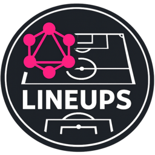
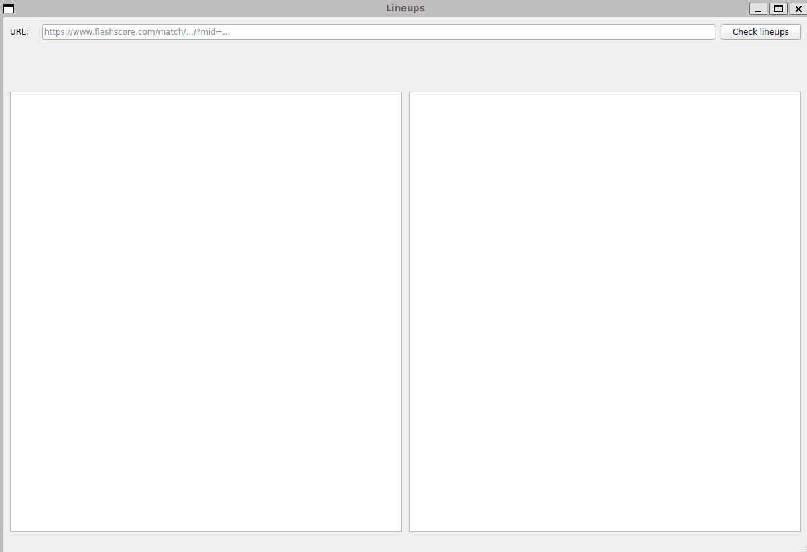
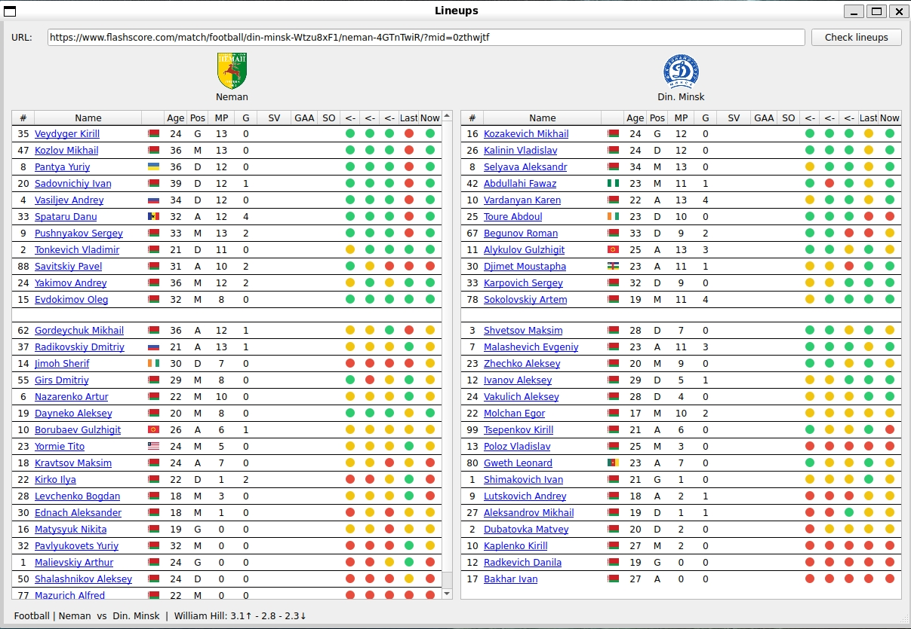
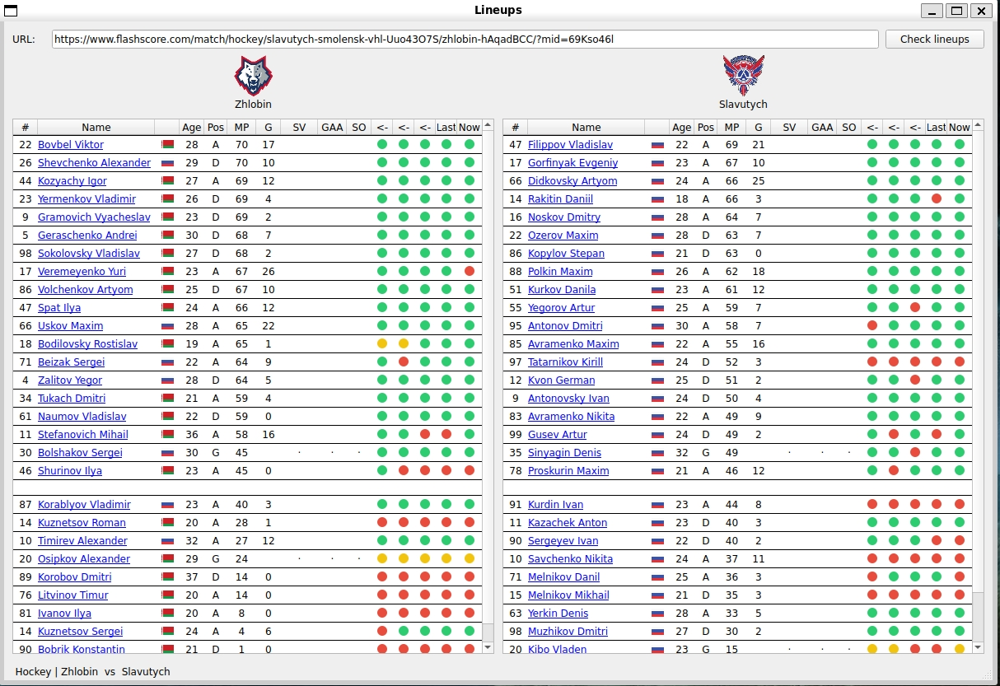

[English](README.md) | Русский

<p align="center">
  
</p>

<h1 align="center">Flashscore Lineups</h1>

<p align="center">
  Десктопное приложение для получения и отображения составов футбольных и хоккейных команд через внутренний 
  GraphQL API Flashscore без автоматизации браузера.
</p>

<p align="center">
  <a href="https://python.org">
    
  </a>
  
  
  
  
  
</p>

<p align="center">
  <a href="#демонстрация">Демонстрация</a> •
  <a href="#возможности">Возможности</a> •
  <a href="#используемые-технологии">Технологии</a> •
  <a href="#технические-особенности">Особенности</a> •
  <a href="#архитектура">Архитектура</a> •
  <a href="#установка">Установка</a>
</p>


## Демонстрация

### Работа приложения

<p align="center">
  
</p>

<table align="center" style="border: none;">
  <tr>
    <td align="center" style="padding: 0 10px;"></td>
    <td align="center" style="padding: 0 10px;"></td>
  </tr>
  <tr>
    <td align="center"><b>Футбол</b></td>
    <td align="center"><b>Хоккей</b></td>
  </tr>
</table>

Приложение получает информацию через внутренний GraphQL API Flashscore и HTML-страницы команд, объединяя в одном интерфейсе 
составы игроков, историю их участия в матчах и доступные букмекерские коэффициенты на исходы матчей (1X2).

Для получения данных не используются Selenium, автоматизация браузера или рендеринг веб-страниц — вся информация загружается через прямые HTTP-запросы.


## Возможности

- Получение составов футбольных и хоккейных команд напрямую с Flashscore
- Отображение стартовых составов, запасных игроков и их позиций
- Отображение статусов игроков за последние 4 матча с помощью цветовых индикаторов
- Получение информации об игроках: гражданство, возраст, количество сыгранных матчей и забитых голов
- Отображение хоккейной статистики вратарей (SV%, GAA, матчи без пропущенных шайб)
- Отображение доступных букмекерских коэффициентов на исходы матчей (1X2) с индикаторами их изменения
- Загрузка логотипов команд и флагов стран напрямую из CDN Flashscore
- Переход к профилям игроков на Flashscore одним нажатием
- Кроссплатформенный графический интерфейс на PyQt5


## Используемые технологии

- **Python 3.12+** — основной язык разработки.
- **PyQt5** — кроссплатформенный графический интерфейс.
- **requests** — HTTP-запросы к сервисам Flashscore.
- **Beautiful Soup 4 / lxml** — разбор HTML и извлечение данных.
- **GraphQL** — получение данных о матчах, составах команд и букмекерских коэффициентах.
- **pytest** — автоматизированное модульное и интеграционное тестирование.
- **PyInstaller** — сборка самостоятельных исполняемых файлов.
- **GitHub Actions** — автоматизация тестирования и сборки приложения для Windows.


## Технические особенности

- Анализ внутренних GraphQL-запросов Flashscore методом обратной разработки (reverse engineering)
- Объединение данных из нескольких источников: сохранённые GraphQL-запросы (persisted queries) и разбор HTML-страниц
- Модели предметной области, реализованные с помощью Python dataclasses
- Автоматизированные модульные и интеграционные тесты на pytest
- Разделение приложения на уровни: модели предметной области, сервисы, пользовательский интерфейс и тесты
- Оптимизация получения данных за счёт прямых HTTP-запросов вместо автоматизации браузера


## Архитектура

```text
                      URL матча
                          │
                          ▼
                  Извлечение ID матча
                          │
                          ▼
                GraphQL API Flashscore
                          │
               ┌──────────┼──────────┐
               │                     │
               ▼                     ▼
             dsof                 dlie2
        (данные матча,         (текущие стартовые
        ID команд,             составы команд,
        последние события)     статусы игроков)
               │                     │
               └──────────┬──────────┘
                          │
                          ▼
                  Предыдущие матчи
                     (dlie2 × N)
                          │
                          ▼
                 HTML-страницы команд
                     (2 команды)
                          │
                          ▼
                Получение коэффициентов
               ┌──────────┴──────────┐
               ▼                     ▼
             pobtm          →    ope2 × N
           (список              (коэффициенты
          букмекеров)            1X2 каждого
                                  букмекера)
                          │
                          ▼
                  Объединение данных
                          │
                          ▼
                    Модели данных
        (Match, Team, Player, Odds, LineupResult)
                          │
                          ▼
                  Интерфейс на PyQt5
```

Приложение объединяет данные, полученные с помощью сохранённых GraphQL-запросов (persisted queries) и дополнительного разбора HTML-страниц. 
Полученная информация преобразуется в строго типизированные модели данных, которые затем используются для отображения в графическом интерфейсе.


## Цветовые обозначения

| Цвет | Статус | Значение |
| ----- | ----- | ----- |
| 🟢 | Основной состав | Игрок вышел в стартовом составе |
| 🟡 | Запасной | Игрок находился на скамейке запасных |
| 🔴 | Отсутствовал | Игрок не был включён в заявку на матч |
| ⚪ | Нет данных | Данные о предыдущих матчах недоступны |


## Установка

Клонируйте репозиторий:

```bash
git clone https://github.com/nikolaitolmachev/flashscore-lineups.git
cd flashscore-lineups
```

Создайте виртуальное окружение:

```bash
python -m venv .venv
```

Активируйте виртуальное окружение в зависимости от операционной системы:

**Linux / macOS**

```bash
source .venv/bin/activate
```

**Windows**

```powershell
.venv\Scripts\activate
```

Установите зависимости:

```bash
python -m pip install --upgrade pip
pip install -r requirements.txt
```

## Использование

Запустите приложение:

```bash
python main.py
```

Вставьте ссылку на матч Flashscore в поле ввода и нажмите кнопку **Check lineups**.


## Скачать приложение

Готовые исполняемые файлы для Windows доступны в разделе [Releases](https://github.com/nikolaitolmachev/flashscore-lineups/releases).

Установка Python не требуется.


## Сборка исполняемого файла

Для самостоятельной сборки приложения используйте PyInstaller:

```bash
pip install pyinstaller

pyinstaller -F -w --icon=assets/icon.ico --name Flashscore-Lineups main.py
```

Готовый исполняемый файл будет находиться в каталоге `dist/`.


## Отказ от ответственности

Проект предназначен исключительно для образовательных целей.

В приложении используются общедоступные веб-ресурсы Flashscore и внутренние GraphQL API, обнаруженные в ходе анализа работы веб-клиента. Все товарные знаки, логотипы и данные принадлежат соответствующим правообладателям.

Проект не является официальным продуктом Flashscore, не поддерживается компанией и никак с ней не связан.


## Лицензия

Проект распространяется по лицензии MIT. Подробнее — в файле [LICENSE](LICENSE).
